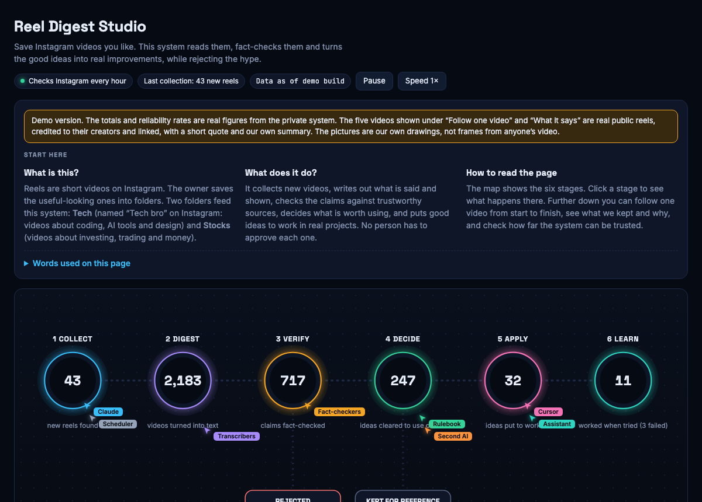

# Reel Digest Studio

### [▶ Open the live demo](https://thefinix13.github.io/reel-digest-studio/)

[](https://thefinix13.github.io/reel-digest-studio/)

An automated loop that turns saved Instagram videos into checked, usable ideas, and a page that shows how every decision was made.

## What it does

1. **Collect** new reels from chosen saved folders (read only).
2. **Digest** each video into text: spoken words plus words shown on screen, on the user's own computer.
3. **Verify** the main claim against trustworthy sources. No source means a claim is never marked true or false. Sales funnels are flagged.
4. **Decide** with written rules (no person approves each item): use now, test first, keep for reference, or reject. A second AI from a different company double-checks anything about to be used.
5. **Apply** accepted ideas to real projects, or record why not.
6. **Learn** from results: ideas that worked are trusted more, ideas that failed are never suggested again.

## Why trust it? It is measured

The page's reliability section reports, with confidence ranges: agreement with earlier hand judgements, a blind audit by an independent AI, how often a second AI agrees, whether the pages relied on are still online, whether tried ideas worked, and whether the same data always gives the same answer. Weak results are shown as weak, and each test that found a problem led to a rule change (see `src/autogate.py`, rule G3b).

## What is in this repository

| Path | What |
|---|---|
| `docs/index.html` | The studio page, one self-contained file |
| `template.html`, `build_demo.py` | Page template and the script that fills it with demo data |
| `aggregates.json` | Real totals and reliability rates from the private system (no personal content) |
| `src/autogate.py` | The decision rules |
| `src/reliability.py` | The reliability measurements |

## Demo data

The five videos under "Follow one video" and "What it says" are real public reels, credited and linked, with a short quote and our own summary. The pictures are our own drawings, not frames from anyone's video. The totals and rates are real. The private system's database, transcripts and project notes are not published.

## Build

```bash
python3 build_demo.py   # writes docs/index.html
```

MIT licence.
